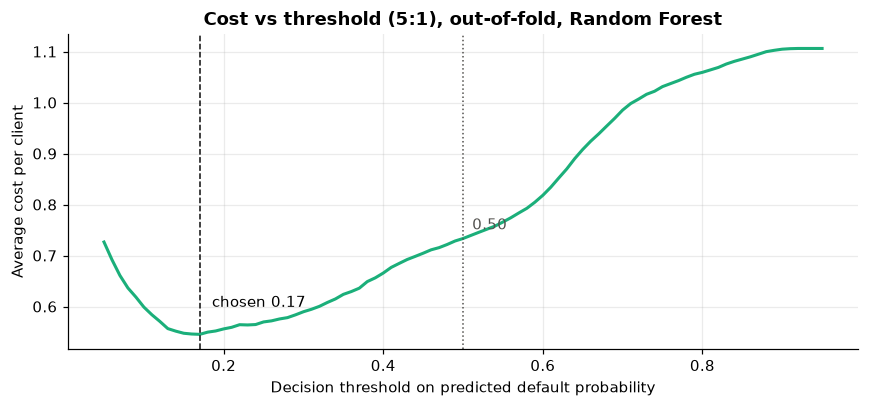
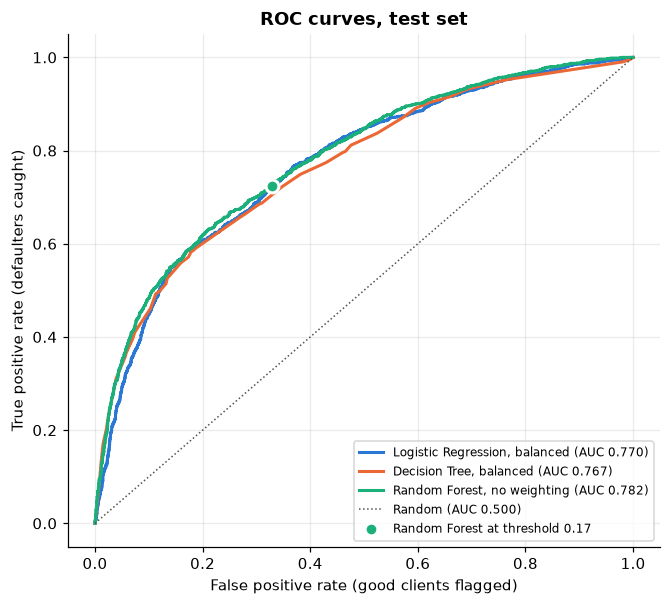
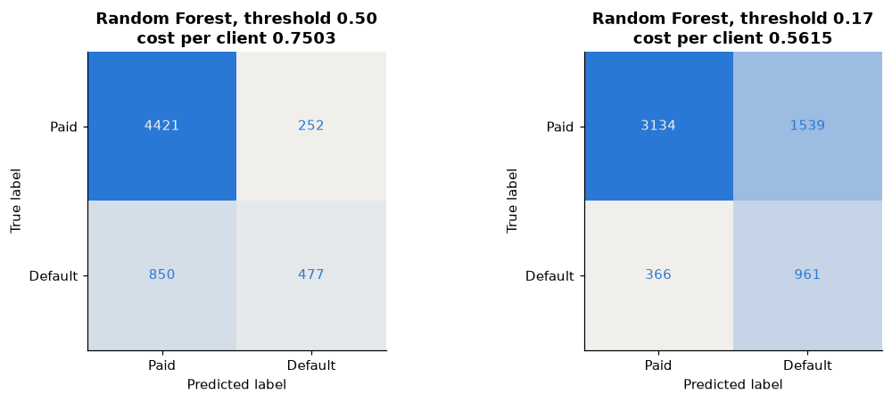
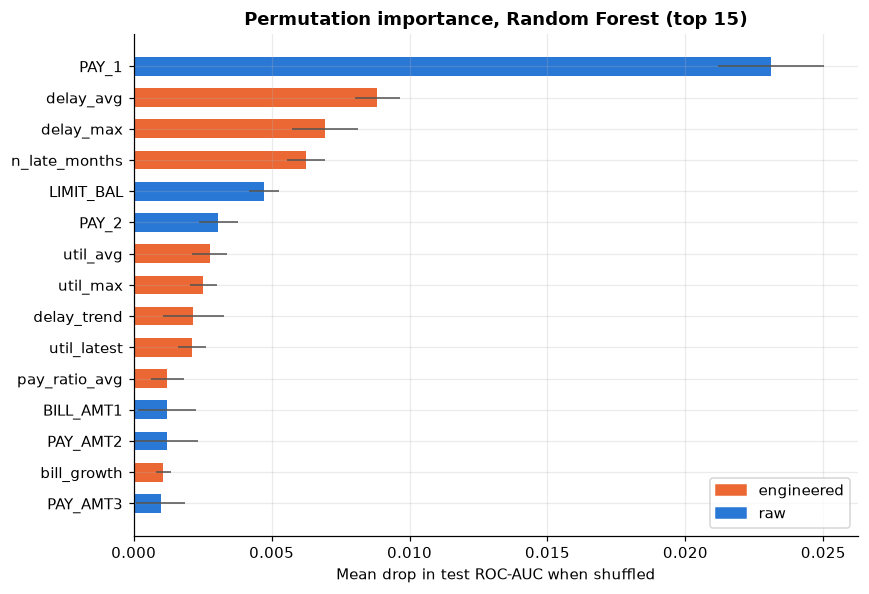

# Task 1: Credit Scoring Model

**CodeAlpha Machine Learning Internship** | Omar Abdelhady

Predicting whether a credit card client will default on next month's payment from six months of billing and
repayment history, comparing Logistic Regression, a Decision Tree and a Random Forest, and choosing the
decision threshold from an explicit business cost.

All code is in [`credit_scoring.ipynb`](credit_scoring.ipynb). Every number below was produced by running that
notebook end to end; the raw outputs are saved in [`results/`](results).

## Problem

A lender has to decide which clients are likely to default. Two mistakes are possible, and they do not cost
the same:

* **Missed defaulter** (false negative): credit keeps flowing to a client who then defaults, and the lender
  loses the outstanding balance. This is a loss of principal.
* **Good client flagged** (false positive): a client who would have paid is rejected or restricted, and the
  lender loses the interest and fees that client would have generated. This is a loss of profit.

The project therefore optimizes **expected cost**, not accuracy. Assumption: a missed defaulter costs **5 times**
as much as a wrongly flagged good client.

## Dataset

[Default of Credit Card Clients](https://archive.ics.uci.edu/dataset/350/default+of+credit+card+clients)
(UCI ML Repository, Yeh and Lien, 2009). 30,000 clients of a Taiwanese bank, April to September 2005,
22.1% defaulters.

| Group | Columns |
|---|---|
| Credit limit | `LIMIT_BAL` |
| Demographics | `SEX`, `EDUCATION`, `MARRIAGE`, `AGE` |
| Repayment status, Sept to Apr | `PAY_1` to `PAY_6` (-2 no use, -1 paid in full, 0 revolving, 1 to 8 months late) |
| Statement amounts | `BILL_AMT1` to `BILL_AMT6` |
| Payments made | `PAY_AMT1` to `PAY_AMT6` |
| Target | `default` (1 = default next month) |

The notebook downloads the data itself (via `ucimlrepo`, with OpenML as a fallback), checks it against the
published shape and class count, and needs no manual download. The original `PAY_0` column is renamed `PAY_1`
so all monthly columns share the same index.

## Approach

1. **Cleaning.** Undocumented codes (`EDUCATION` 0, 5, 6 and `MARRIAGE` 0) are folded into the existing
   "other" category.
2. **Split first.** Stratified 80/20 train/test split before any analysis. EDA, tuning, model selection and
   threshold selection all use the training set only; the test set is used once, at the end.
3. **EDA** on the training set: class balance, default rate by repayment status, distributions of money
   variables, Spearman correlations.
4. **Feature engineering** (12 features, computed per client with fixed formulas, so no leakage):

   | Feature | Idea |
   |---|---|
   | `util_latest`, `util_avg`, `util_max` | Bill / credit limit: how stretched the client is |
   | `delay_avg`, `delay_max`, `n_late_months` | Severity and frequency of late payments |
   | `n_paid_full` | Months paid in full: a low-risk "transactor" pattern |
   | `delay_trend` | Recent 3 months vs earlier 3 months: is behaviour getting worse? |
   | `pay_ratio_latest`, `pay_ratio_avg`, `n_low_pay_months` | Share of the previous bill actually repaid |
   | `bill_growth` | Balance growth relative to the limit: accumulating debt |

5. **Leak-free preprocessing** inside scikit-learn pipelines: signed log transform + `StandardScaler` for money
   columns, `StandardScaler` for other numeric columns, `OneHotEncoder` for `EDUCATION`. Scalers and encoders
   are fitted only on training data in every fold.
6. **Protected attributes.** `SEX`, `MARRIAGE` and `AGE` are excluded from the models, as fair-lending rules
   would require in many jurisdictions. Adding them back changed CV ROC-AUC by only +0.0007.
7. **Models:** Logistic Regression, Decision Tree, Random Forest, each with a small grid search (5-fold CV,
   ROC-AUC), then compared **with and without** `class_weight="balanced"` on the same 5 folds.
8. **Threshold:** chosen by minimizing average cost (5 x missed defaulters + 1 x false alarms) on
   **out-of-fold** training predictions.
9. **Evaluation** on the held-out test set with precision, recall, F1, ROC-AUC, PR-AUC, confusion matrices,
   ROC curves and cost, plus permutation feature importance.

## Results

### Cross-validation (training set, 5 folds, mean ± std)

Precision, recall and F1 are for the default class at the default 0.5 threshold.

| Model | Class weight | Precision | Recall | F1 | ROC-AUC | PR-AUC |
|---|---|---|---|---|---|---|
| Logistic Regression | none | 0.656 ± 0.012 | 0.316 ± 0.011 | 0.427 ± 0.012 | 0.766 ± 0.006 | 0.523 ± 0.007 |
| Logistic Regression | balanced | 0.453 ± 0.008 | 0.629 ± 0.011 | 0.527 ± 0.008 | 0.769 ± 0.004 | 0.518 ± 0.006 |
| Decision Tree | none | 0.673 ± 0.012 | 0.358 ± 0.017 | 0.467 ± 0.015 | 0.771 ± 0.003 | 0.533 ± 0.008 |
| Decision Tree | balanced | 0.455 ± 0.009 | 0.634 ± 0.024 | 0.530 ± 0.006 | 0.772 ± 0.004 | 0.534 ± 0.009 |
| Random Forest | none | 0.675 ± 0.007 | 0.373 ± 0.006 | 0.480 ± 0.005 | **0.787 ± 0.005** | **0.563 ± 0.009** |
| Random Forest | balanced | 0.482 ± 0.012 | 0.626 ± 0.015 | 0.544 ± 0.010 | 0.786 ± 0.005 | 0.561 ± 0.010 |

Tuned settings: Logistic Regression `C=10`; Decision Tree `max_depth=6, min_samples_leaf=100`;
Random Forest (300 trees) `max_depth=10, min_samples_leaf=20`.

* **Class weighting moves the operating point, not the ranking.** It roughly doubles recall at 0.5 and lowers
  precision, but ROC-AUC and PR-AUC change by at most 0.005, within the fold-to-fold spread. Weighting is
  effectively a lower threshold, so the threshold is chosen explicitly instead.
* **Random Forest ranks clients best.** The unweighted forest has the highest mean CV ROC-AUC and was selected;
  it is effectively tied with the weighted one.
* **Feature engineering helps most where expected.** CV ROC-AUC with vs without the engineered features:
  Logistic Regression 0.749 to 0.769 (+0.020), Random Forest 0.782 to 0.786 (+0.004). A linear model cannot
  build counts and ratios by itself, a forest partly can.

### Decision threshold

With costs of 5:1, the cost-minimizing threshold on out-of-fold predictions is **0.17**, matching the
theoretical 1/6 for calibrated probabilities. It cuts the out-of-fold cost per client from 0.733 (at 0.5) to
0.546.



### Held-out test set (6,000 clients, 1,327 defaulters)

| Model | Threshold | Precision | Recall | F1 | ROC-AUC | Defaulters caught | False alarms | Cost per client |
|---|---|---|---|---|---|---|---|---|
| Rule: `PAY_1 >= 1` (no model) | n/a | 0.500 | 0.505 | 0.502 | n/a | 670 | 670 | 0.659 |
| Logistic Regression (balanced) | 0.50 | 0.447 | 0.616 | 0.518 | 0.770 | 818 | 1,011 | 0.593 |
| Decision Tree (balanced) | 0.50 | 0.481 | 0.583 | 0.527 | 0.767 | 773 | 834 | 0.601 |
| Random Forest (no weighting) | 0.50 | 0.654 | 0.359 | 0.464 | 0.782 | 477 | 252 | 0.750 |
| **Random Forest (no weighting)** | **0.17** | 0.384 | **0.724** | 0.502 | **0.782** | **961** | 1,539 | **0.562** |

For reference: approving everyone costs 1.106 per client; always predicting "no default" gives 0.779 accuracy
while catching zero defaulters, which is why accuracy is not used.

* The final model (Random Forest at 0.17) has the **lowest cost** of all options: about 25% below the same
  model at 0.5 and about 15% below the simple rule, while catching 72% of defaulters.
* Test ROC-AUC (0.782) is close to the CV estimate (0.787), so the model generalizes as expected.
* F1 does not separate the final model from the rule (both 0.502) because F1 treats both errors as equally
  costly; the business cost does not, and it clearly favours the model.





### Feature importance (permutation, test set)

The most recent repayment status (`PAY_1`) dominates. The next three features are engineered delinquency
summaries (`delay_avg`, `delay_max`, `n_late_months`), and 7 of the top 10 are engineered, including all three
utilization features. Credit limit is the strongest non-delinquency signal.



## Limitations

* **Old, single-source data.** One Taiwanese bank in 2005, during a local credit card debt crisis; results may
  not transfer to other markets or periods without retraining and monitoring.
* **Thin features.** Six months of behaviour, no income, bureau data or other debts, which caps performance.
  A test ROC-AUC of about 0.78 means many flagged clients would still have paid, so the model suits routing to
  review or limit adjustments better than automatic rejection.
* **The 5:1 cost ratio is an assumption.** A real lender would estimate loss given default and per-client
  margin; the cost curve makes re-deriving the threshold straightforward.
* **Calibration was not verified** beyond the threshold matching 1/6. If probabilities feed pricing or expected
  loss, check a reliability curve and calibrate.
* **Tuning and model comparison share the training folds,** so CV scores are slightly optimistic; the untouched
  test set is the unbiased check.
* **Fairness.** Dropping protected attributes does not rule out proxy effects; a production model would need
  disparate-impact testing.

## How to run

```bash
# from the task1_credit_scoring folder, ideally in a fresh virtual environment (Python 3.11+)
pip install -r requirements.txt
jupyter notebook credit_scoring.ipynb      # then Run All
```

Internet access is needed on the first run to download the dataset (a few MB). Running the whole notebook
takes roughly 5 to 6 minutes on a 2-core machine, mostly Random Forest cross-validation. All randomness is
seeded (`RANDOM_STATE = 42`), and rows are put in a fixed order before splitting, so results are reproducible
whichever source the data comes from. To work offline, put the UCI file at
`data/default of credit card clients.xls` and the notebook will use it instead.

## Files

```
task1_credit_scoring/
├── credit_scoring.ipynb   # full analysis, executed with outputs
├── requirements.txt
├── README.md
├── figures/               # plots used in this README (written by the notebook)
└── results/               # CV, ablation, test and importance tables as CSV (written by the notebook)
```

## Reference

Yeh, I. C., and Lien, C. H. (2009). The comparisons of data mining techniques for the predictive accuracy of
probability of default of credit card clients. *Expert Systems with Applications*, 36(2), 2473-2480.
