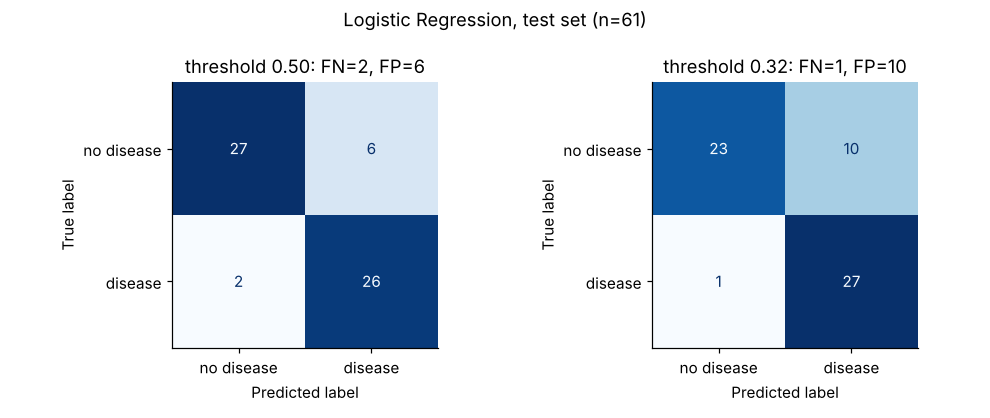
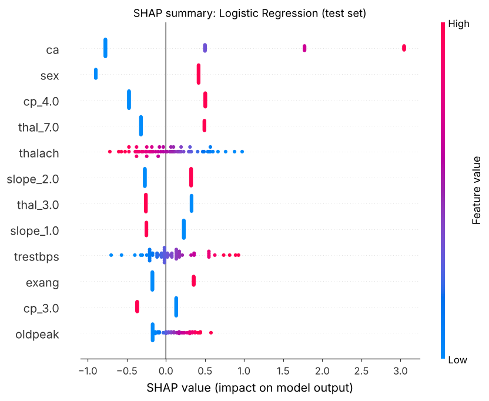

# Task 4: Disease Prediction from Medical Data

CodeAlpha Machine Learning Internship · Omar Abdelhady

> **Educational model only. Not for clinical use.** This model was built for an internship task on 303 patients from a single hospital in the 1980s. It has not been externally validated and must not be used to make or support any medical decision.

## Problem

Predict whether a patient has heart disease from routine clinical data (age, sex, chest pain type, blood pressure, cholesterol, ECG, exercise test and imaging results). This is binary classification, and because missing a sick patient is far worse than a false alarm, the model is tuned to prioritise **recall** (sensitivity).

## Dataset

[UCI Heart Disease, Cleveland subset](https://archive.ics.uci.edu/dataset/45/heart+disease) (`processed.cleveland.data`): 303 patients, 13 features, Cleveland Clinic Foundation.

- **Loaded in code**, no manual download. The notebook tries the official UCI URL first and falls back to a public GitHub copy of the same file if UCI is unreachable. Either way it checks the content against the UCI documentation (303 rows, 14 columns, missing-value counts, class counts of `num`) and stops if anything differs. The run that produced the results below used the GitHub copy, because UCI was not reachable from the build environment; the file passed all checks.
- **Target:** the original `num` (0 = no disease, 1 to 4 = disease of increasing severity) is binarized to `target = 1 if num > 0`, the standard use of this dataset. Result: 164 without disease, 139 with disease (45.9%), so close to balanced.
- **Missing values:** 6 values in 6 rows (4 in `ca`, 2 in `thal`). Rows are kept and imputed **inside the pipeline**: median for `ca` (a skewed 0 to 3 count, median keeps it a valid integer) and most frequent for `thal` (categorical). Imputers are fitted on training data only.

## Approach

1. **Split first:** stratified 80/20 split (242 train, 61 test, seed 42). The test set is used once, at the end.
2. **Preprocessing in an sklearn `Pipeline` + `ColumnTransformer`**, so everything is fitted on training folds only (no leakage):
   - continuous and count features (`age, trestbps, chol, thalach, oldpeak, ca`): median imputation, standardization
   - nominal features (`cp, restecg, slope, thal`): most-frequent imputation, one-hot encoding (their integer codes are labels, not quantities)
   - binary features (`sex, fbs, exang`): most-frequent imputation, passed through
3. **Models:** Logistic Regression, SVM (Platt-calibrated for probabilities), Random Forest, XGBoost, each tuned with `GridSearchCV` (5-fold stratified, scoring ROC-AUC).
4. **Honest scores with nested cross-validation:** the full grid search is wrapped in an outer 5-fold × 3-repeat stratified CV on the training set, so reported scores are not inflated by the tuning.
5. **Threshold for a medical setting:** for the best model, out-of-fold training predictions are used to pick the highest threshold that reaches at least **90% recall**, then that threshold is frozen and applied to the test set.
6. **Interpretability:** permutation importance on the original features, SHAP values, and model coefficients.

## Results

All numbers below come from the executed notebook (`results/summary.json`).

**Nested cross-validation (training set, 15 outer folds, mean ± std, threshold 0.5).** This is the main basis for comparing models.

| Model | ROC-AUC | Recall | Precision | F1 | Accuracy |
|---|---|---|---|---|---|
| Logistic Regression | **0.892 ± 0.044** | 0.780 ± 0.082 | 0.849 ± 0.082 | 0.808 ± 0.049 | 0.831 ± 0.043 |
| SVM | 0.887 ± 0.048 | 0.753 ± 0.085 | 0.837 ± 0.075 | 0.789 ± 0.062 | 0.817 ± 0.050 |
| Random Forest | 0.891 ± 0.039 | 0.771 ± 0.095 | 0.812 ± 0.070 | 0.787 ± 0.067 | 0.811 ± 0.054 |
| XGBoost | 0.875 ± 0.039 | 0.774 ± 0.093 | 0.790 ± 0.059 | 0.777 ± 0.055 | 0.799 ± 0.048 |

The models are within about 0.02 ROC-AUC of each other, smaller than the fold-to-fold spread, so none is clearly better. Logistic Regression has the highest mean ROC-AUC and was selected; it is also the easiest to explain.

**Held-out test set (61 patients, 28 with disease), threshold 0.5.**

| Model | Precision | Recall | F1 | ROC-AUC | Accuracy |
|---|---|---|---|---|---|
| Logistic Regression | 0.812 | 0.929 | 0.867 | 0.958 | 0.869 |
| SVM | 0.839 | 0.929 | 0.881 | 0.960 | 0.885 |
| Random Forest | 0.839 | 0.929 | 0.881 | 0.955 | 0.885 |
| XGBoost | 0.862 | 0.893 | 0.877 | 0.955 | 0.885 |

Test ROC-AUC is higher than the nested CV estimate, most likely a favourable split of only 61 patients; the nested CV figures are the expected performance.

**Recall-first threshold (Logistic Regression).** The 90%-recall rule picked a threshold of **0.316** on out-of-fold training predictions (recall 0.901, precision 0.730, versus recall 0.829 and precision 0.860 at 0.5).

| Test set | Precision | Recall | F1 | False negatives | False positives |
|---|---|---|---|---|---|
| threshold 0.5 | 0.812 | 0.929 | 0.867 | 2 | 6 |
| threshold 0.316 | 0.730 | 0.964 | 0.831 | 1 | 10 |

One more sick patient is caught at the cost of four more healthy patients being sent for follow-up tests, the intended trade-off when a missed diagnosis is the costlier error.



**Most influential features:** `ca` (vessels colored by fluoroscopy) dominates both permutation importance and SHAP, followed by chest pain type, thallium result, slope, ST depression and maximum heart rate. These match known cardiology markers; the notebook discusses each one, including why `cp` = asymptomatic raises risk and why age and cholesterol contribute little here.



## Limitations

- Small sample (303 patients, 61 in test): single-split test metrics move by several points per patient.
- Old, single-centre data from patients already referred for angiography, so the disease rate (46%) is far above the general population. Precision would drop and the threshold would need re-tuning elsewhere.
- `ca` and `thal` come from diagnostic procedures, so the model is not a cheap pre-test screen as it stands.
- Severity grades are merged into a binary target.
- No external validation and no probability calibration study.

**Educational model, not for clinical use.**

## Repository contents

```
task4_disease_prediction/
├── disease_prediction.ipynb   # full analysis, executed with outputs
├── requirements.txt
├── README.md
├── figures/                   # plots saved by the notebook
└── results/summary.json       # every number quoted in this README
```

## How to run

```bash
cd task4_disease_prediction
python -m venv .venv
source .venv/bin/activate        # Windows: .venv\Scripts\activate
pip install -r requirements.txt
jupyter notebook disease_prediction.ipynb     # then Run All
# or headless:
jupyter nbconvert --to notebook --execute --inplace disease_prediction.ipynb
```

Needs an internet connection the first time (the dataset is downloaded in code). A full run takes about 5 minutes on a 2-core machine, mostly the nested cross-validation. All randomness uses seed 42.
